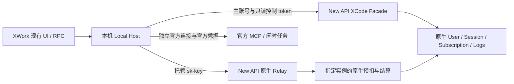

# XCode / XWork 私有网关：New API 实现规范

状态：已进入实现与本机联调，U01–U04 升级页增量已落地；完整完成门槛仍按执行计划和 §11 逐项验收。本文件规定目标契约，不能将某项实现或本机验证等同于全部场景通过。

本文件是跨仓库 HTTP、凭据、授权与计费契约的唯一规范源；客户端实现见 [XCode spec](../../../XCode/docs/xcode/specs/new-api-integration.md)。XCode 是仓库目录名，该 checkout 的产品展示名称是 XWork；本方案不重新命名产品，也不移除 New API / QuantumNous 标识及归属。

## 1. 基线与取证边界

| 项目         | 已核对的事实                                                                                     |
| ------------ | ------------------------------------------------------------------------------------------------ |
| New API 源码 | `973cf8ef4600947a4270e95ada7916740fa8264c`，`main`                                               |
| XCode 源码   | `7740b06bb501e1dce2ab5db867a5f0c3365e4f1a`，`feature/private-server-technical-design`            |
| 本机服务     | `http://127.0.0.1:3001`；公开 `GET /api/status` 返回 `success=true`                              |
| 运行载体     | Docker `new-api`，发布 `127.0.0.1:3001 -> 3000`；挂载本仓库 `data`，从挂载的 `/app/new-api` 启动 |
| 版本限制     | status 的 version 为空；未证明运行二进制与上述源码 SHA 一致，不能用 image 的 `latest` 标签作证明 |
| 地址限制     | status 的 `server_address` 与实际开发端口不同；本期使用显式配置的真实 origin，不自动采用该字段   |

关键源码依据：

- [原生登录/刷新/撤销契约](../authentication.md)、[JWT claims 与 audience](../../service/auth_token.go#L19)、[Session 签发与刷新](../../service/auth_session.go#L52)、[UserSession](../../model/user_session.go#L42)、[一次性 AuthFlow](../../model/auth_flow.go#L45)。
- [原生订阅模板与实例](../../model/subscription.go#L145)、[创建实例](../../model/subscription.go#L484)、[管理员授予入口](../../controller/subscription.go#L420)、[套餐管理界面](../../web/src/features/subscriptions/components/dialogs/user-subscriptions-dialog.tsx#L107)。
- [计费来源选择](../../service/billing_session.go#L379)、[订阅预扣](../../service/funding_source.go#L80)、[实际候选选择](../../model/subscription.go#L1298)、[任务按原实例结算](../../service/task_billing.go#L111)。
- [模型元数据](../../model/model_meta.go#L35)、[模型编辑界面](../../web/src/features/models/components/drawers/model-mutate-drawer.tsx#L19)、[消费/退款日志](../../model/log.go#L59)、[小时导出数据](../../model/usedata.go#L13)、[数据库迁移注册](../../model/main.go#L342)。

现状不是直接替换 upstream URL 即可完成：订阅预扣目前从用户全部有效订阅中选取；原生 Session JWT 都是面板 audience；模型元数据没有 XCode 所需的完整能力结构。上述三个边界必须修改。

## 2. 已确认的业务规则

| 边界       | 本期规则                                                                                                                 |
| ---------- | ------------------------------------------------------------------------------------------------------------------------ |
| 部署范围   | 用户最终明确：开发期全部在本机启动、部署、访问。覆盖桌面 Local Host；不实现远程接入、转发、凭据下发或独立 Web 多用户登录 |
| 模型服务   | 普通 Agent 的 BigModel / Z.ai 个人、企业及 Start 官方 Plan 通道全部改为 New API 私有网关；用户自配 API Provider 不改     |
| 主账号     | 使用 New API 原生登录、注册及已启用的安全校验；不重建一套账号、密码或企业组织体系                                        |
| 客户端界面 | 保留布局、导航、组件和交互；供应商/套餐名、单位、周期等数据文案按真实后端适配                                            |
| 套餐       | 原个人、企业、Start 入口统一展示原生用户订阅；不创建企业 org/project、Start 独立钱包或赠送桶                             |
| 授权来源   | 管理员从原生模板新授予。不做已有用户/订阅迁移、认领或绑定既有订单订阅                                                    |
| 唯一性     | 每用户最多一个当前 XCode 指定授权。其他原生订阅允许共存，但不是 XCode 的后备资金来源                                     |
| 额度隔离   | 指定实例仅供 XCode 托管凭据使用；普通 New API key 不能扣它，XCode 不能扣钱包或其他原生订阅                               |
| 续期       | 同套餐未到期：从原 end_time 顺延一个模板时长，保留额度总量、已用量和当前周期进度；到期后新建实例                         |
| 换套餐     | 一个事务内取消 A、从现在新建 B、更新指定关系；不折算时间、不结转额度，保留历史                                           |
| 重置       | 原生单周期：never / daily / weekly / monthly / custom；自动或管理员重置。不实现用户额外重置机会                          |
| 支付       | 仅 XCode 入口及凭据禁止自助订阅/支付。New API 原生面板支付继续可用；不能全局关闭其购买路由                               |
| 用量       | 云端模型统计为 New API 用户全部消费，包含其他原生订阅及钱包；套餐卡只显示指定实例，二者必须标明不同范围                  |
| 缺失统计   | 保留 UI 卡片，明确显示暂不提供。不能伪造 Agent 时长、工具执行/错误、GLM Pro/Lite 解码速度                                |
| 模型目录   | 真实授权模型及管理员维护的完整能力元数据；不猜模型别名、上下文长度或工具能力                                             |
| 官方云服务 | Server MCP、闲时/云任务继续官方服务、官方模型与官方计费；需要独立官方登录和真实官方权益                                  |
| 云凭据     | 按 New API 主用户隔离保存，仅同一主用户可恢复；私有 token 不发送到官方服务                                               |
| 原模型选择 | 已保存的官方 Plan 选择统一要求重选；不自动映射，即使模型 ID 相同。保留会话历史及自配 Provider                            |

“仅供 XCode”是托管凭据及资金域限制，不是证明 HTTP 调用一定来自官方桌面进程；持有被盗 relay key 的程序仍可能冒用。不能将 `User-Agent`、客户端名称或 key 名称当作身份认证。

## 3. 最小架构与所有权



不搭建第二个用户中心、订阅账本、余额账本、通用 IdP 或账单转换服务。Facade 放在根模块的 Router → Controller → Service → Model 层，`relaykit/` 不依赖根模块或 XCode 源码。

### 3.1 必要的持久化扩展

以下名称为目标字段/模型名，不是现有实现：

| 对象                           | 扩展与不变量                                                                                                                                                                                |
| ------------------------------ | ------------------------------------------------------------------------------------------------------------------------------------------------------------------------------------------- |
| `UserSession`                  | `ClientPurpose`：空/`dashboard` 为原生，`xcode` 为客户端专用；服务端签发，普通请求不可修改。进入缓存和 Session 校验                                                                         |
| `Token`                        | `ClientPurpose` 与 `ClientSessionSID`：XCode 托管 key 固定为 `xcode`，链接同用户的专用 Session；名称只用于展示。关联缺失也不能降级为普通 key                                                |
| `UserSubscription`             | `UsageScope`：空/general 为原生通用，xcode 为专用且不可改回。专用实例增加不可变 `QuotaResetPeriodSnapshot` / `QuotaResetCustomSecondsSnapshot`，以及 `QuotaResetGeneration`；不复制余额账本 |
| 新 `XCodeAuthorization`        | `UserId` 唯一；`SubscriptionId` 指向最近指定实例；`Revision`、更新时间。无实例时 revision 为 0；有效性从真实实例状态及数据库时间判断，不复制额度                                            |
| `Model` 元数据                 | `XCodeConfig` TEXT，保存 §7 的版本化 JSON。管理员维护；官方描述同步、非相关字段编辑不得覆盖它                                                                                               |
| `SubscriptionPreConsumeRecord` | 专用请求增加 `FundingScope`、`ResetGeneration`、`CycleReservedQuota`、`FinalQuota`；Status 扩展 settled，统一保存本请求预扣/追加预留/结算/退款事实。沿用原表，不新建周期余额账本            |

原生 `UserSubscription` 的 `AmountTotal/AmountUsed/StartTime/EndTime/LastResetTime/NextResetTime` 仍为唯一计费事实。不要在授权关系中保存可独立扣减的剩余额度。

使用 GORM 迁移，兼容 SQLite、MySQL ≥5.7.8、PostgreSQL ≥9.6。已有行按原生用途解释；不改写既有订阅归属，不自动创建 XCode 授权。唯一性使用普通 UserId 唯一索引及事务，不依赖 partial index、数据库 enum 或 `default:true`。

Token Redis hash 的现有固定字段编码必须加入 ClientPurpose/ClientSessionSID 和明确 cache schema version；Session cache 同样包含 ClientPurpose。旧 schema、字段缺失或未知 purpose 作为不可信 cache miss 回源数据库，不能用空值当 general。切换缓存 schema/namespace 时清理旧 hash，复用 mutation fence，冷启动/热缓存/缺字段路径行为一致；禁用入口也不绕过分类。依据 [Token cache 序列化](../../model/token_cache.go#L56)。

### 3.2 事务与版本

管理员写操作按用户行 → 指定关系 → 订阅实例的顺序持锁，使用 `lockForUpdate(tx)`。SQLite 使用项目支持的事务写串行及冲突处理，不声称其有 `FOR UPDATE`。

请求必须带 `expected_revision`；提交时一致才执行，成功递增 revision，不一致返回 409。双击续期、并发换套餐不得重复顺延或创建两个有效实例。所有金额/周期相关校验和记录写入必须在同一事务；缓存及用户分组刷新在提交后执行。

## 4. 主账号与凭据

### 4.1 三种凭据必须分离

| 凭据             | 目标用途                                                                                                    | 存放与生命周期                                                                              |
| ---------------- | ----------------------------------------------------------------------------------------------------------- | ------------------------------------------------------------------------------------------- |
| 控制 Access JWT  | `aud=new-api-xcode`、`token_use=xcode_access`；固定只读 scopes：`profile:read`、`wallet:read`、`usage:read` | Local Host；沿用 15 分钟，且不能晚于 Session 到期                                           |
| Refresh Token    | 专用原生 UserSession 的随机 refresh；复用原生 HMAC、轮换、重放保护与撤销                                    | 只在本机安全凭据库；最长沿用 30 天绝对 Session 寿命，不进 Renderer、URL、日志或 Web Storage |
| 托管 Relay Token | 原生 `sk-` key，关联专用 SID；仅允许本规范的模型推理路由                                                    | Host/现有本机 Agent 凭据传输；到期不晚于 SID；无独立余额资金域                              |

托管 Token 显式使用原生 `UnlimitedQuota=true`，表示不另设 key 额度，并非套餐无限；额度仍由指定 UserSubscription 决定。Group 不覆盖原生当前用户组；模型限制由真实授权目录和 metadata 校验执行。创建同样遵守原生 key 数量限制，不能用默认 RemainQuota=0 误拦截全部请求或按 key 钱包额度收费。

不使用全权限面板 JWT 或 PAT 作为客户端控制凭据。复用 `authClaims`、原生签名/解析代码与 Session 状态，而不是另建认证数据库。新增用途应有独立 signing purpose；原生 dashboard、安全 proof、XCode control、Web 只读凭据不可互换。

原生登录页仍产生原生浏览器 Session。客户端兑换创建另一个 `ClientPurpose=xcode` 的 Session，计入现有 Session 数量及签发限额。不会把授权用的浏览器 SID 改成客户端 SID；退出 XCode 只撤销其客户端 Session，原生浏览器登录保留。

### 4.2 Authorization Code + PKCE

1. Local Host 生成一次登录的随机 state、PKCE verifier 和 S256 challenge；state 至少 128 bit 随机性，verifier 遵守 RFC 7636。verifier 留在 Host。
2. 浏览器进入 New API 的授权入口。未登录时复用原生登录/注册、安全校验；返回目标只能是服务端校验过的本源授权页。
3. 服务端保存短期 `AuthFlow`，绑定 client_id、精确 redirect_uri、state、challenge；授权请求期限 10 分钟。浏览器完成授权时必须带有效原生浏览器 Bearer，不能仅凭 query user_id 完成。
4. 一次性 code 使用独立 AuthFlow purpose，期限 60 秒；绑定经过验证的用户、来源 Session/auth_version、客户端、回调及 challenge。来源会话失效或安全版本变化时不得兑换。
5. Aiscoo 桌面回调精确登记为 `aiscoo://oauth/callback`、`aiscoo-dev://oauth/callback`、`aiscoo-preview://oauth/callback`，兼容保留 `zcode://oauth/callback`；附 `provider=new-api`、code、state，不包含 access/refresh/relay key。不经过官方网站中转。
6. Host 核对 state、当前登录 generation、provider 及授权 origin，携 verifier 兑换。code 的原子消费、专用 Session、托管 key 建立必须一起成功或回滚。
7. Host 仅在本轮仍有效时持久化凭据和发布主账号。取消/被新登录覆盖的迟到结果不发布；已取得迟到凭据时立即撤销其 SID，不覆盖另一轮登录。

client_id 是公开标识，不是 secret。桌面 `xcode-desktop` 仅允许上述四个完整回调 URI，按原始字符串精确匹配；拒绝大小写变体、userinfo、端口、query、fragment、转义路径和尾斜杠。服务端现无 dev/preview 专用开关，三个 Aiscoo 回调沿用现有 `XCODE_INTEGRATION_ENABLED` 与 `XCODE_PUBLIC_ORIGIN` 入口控制，不新增通配 scheme 或环境回退。授权网页仅为桌面客户端分发这四种回调及原有三个查询参数，不扩展 Web origin 或 CLI。独立 CLI 注册为 `xwork-cli`，仅允许 `http://127.0.0.1:<port>/oauth/callback`，port 为 1–65535 的规范十进制；禁止 localhost/其他 IP 表示、userinfo、query、fragment、转义路径和尾斜杠。CLI 必须先绑定系统分配的回环端口，再发起授权；浏览器须与 CLI 在同一台机器。完整 redirect_uri 与 client_id 绑定 AuthFlow 和 code，兑换时精确一致；即使是同一桌面客户端已登记的其他回调也不能换用或借重放撤销会话。不支持任意 redirect_uri、通配 scheme/host 或动态第三方客户端注册。PKCE 必須是 S256，不能回退 plain。

专用 UserSession 持久化 client_id；旧 xcode-purpose 会话的空值仅解释为 xcode-desktop。refresh 与使用 refresh 凭据的 logout 必须匹配签发客户端；不匹配时不轮换、不撤销。control 凭据 logout 只操作已验证的自身 SID。客户端标识不改变 xcode 资金用途、指定套餐与 managed key 范围。

CLI 登录采用原生浏览器授权和独立 SID；不复制桌面密钥或会话。适用 OWASP Authentication、Session Management、OAuth2 Cheat Sheets：保留原生认证强度、S256 与 state、精确回调匹配、单次且有期限的 code、刷新轮换与撤销、服务端客户端归属校验，审计不记录可用凭据。本增量不声称对全产品作 ASVS 合规认证。

授权页支持当前浏览器的单会话账户切换，不建立独立授权会话或多账户中心。切换前必须提示：退出当前浏览器会话会影响其他已打开的同源 New API 后台页面；重新登录后仍须主动确认授权，登录本身不是授权。换号及登录往返不续期原 10 分钟请求；过期后须从桌面重新发起。正常授权创建独立桌面设备 Session，浏览器保持登录；明确换号只针对确认时的浏览器 SID，不撤销其他桌面设备 Session。

换号复用原生 `POST /api/user/auth/logout` 与 `X-Auth-Session`，固定确认时的非空 SID；显式空 SID 必须拒绝，409 `AUTH_SESSION_MISMATCH` 必须结束本次退出，不能刷新后追随新账户重试。固定 SID 分支使用现有 Axios fetch adapter 的 `credentials: omit`（`adapter: 'fetch', withCredentials: false`），同时不发送浏览器 Cookie、不接收响应 Set-Cookie，仍携原生 Bearer 与固定 SID；不能用同源 XHR 的 `withCredentials: false` 代替。只有 `success:true` 且既有响应 `data.revoked_sid` 精确匹配目标，才确认实际撤销；无凭据/过期 Bearer 导致的匿名成功、缺失或不匹配撤销证明均失败关闭，不清理、不跳转、不重试。普通无参数退出及 OAuth 调用者保留原有 Cookie 与 mismatch recovery 行为，不改后端接口/协议。页面操作仍归属原身份时才统一清理浏览器状态并跳登录，失败或迟到响应不得清理新身份或其刷新 Cookie / hint；不能在旧响应后主动删除共享 hint。原 A 的 Cookie 可以暂留但服务端 SID 已撤销，不能据 Cookie 存在宣称 A 仍登录，后续原生认证处理该无效 Cookie。页面布局、身份归属、跨标签同步及一次性主动授权规则见 [授权页 UI 规格](../../../XCode/docs/xcode/specs/new-api-authorization-account-switch.md)，该规格不另行定义 HTTP 契约。

不新增远程/CLI polling 登录。若原生注册、安全验证未完成、请求/code 过期，保持原 UI 的明确失败及重新登录操作；不制造成功会话。

### 4.3 不可越权的 Session 目的

必须同时修改签发、解析分类、Session 校验、refresh/controller 边界：

- XCode audience/use 被识别为内部 JWT；签名错误、过期、用途错误时直接拒绝，不能落入 PAT、旧 access token 或 relay-key 认证。
- XCode JWT 仅进入 §6 声明的客户端控制路由；即使用户是 root/admin，也不能管理用户、key、Session、付款或账户安全。
- 原生 dashboard middleware 不接受 XCode Session。仅改变 JWT 的 audience 不足以隔离。
- 原生 `/api/user/auth/refresh` 不得为 `ClientPurpose=xcode` 签发 dashboard JWT；Cookie 伪装也不能升级用途。专用 refresh 只能轮换该 SID 并产生 XCode JWT。
- 原生用户 Session 管理仍能查看/撤销 XCode 设备；原生密码/安全因子变更及 revoke-all/revoke-others 会使关联托管 key 失效。
- Relay admission 校验同用户、SID 活跃、当前 auth_version、token 目的及有效期。refresh 轮换的 SessionVersion 不应无故使同 SID 的 relay key失效；安全变更/撤销则必须失效。
- 用户通过原生 key 管理删除/停用托管 key 时，撤销其专用客户端 Session；不能后台自动重建被明确撤销的凭据。原生 CRUD 不得修改其目的、SID、资金域、无限额度标记等受管字段。

Session 缓存、撤销 tombstone 和多节点传播语义沿用 [认证文档](../authentication.md#多节点-redis-拓扑)，不宣称超过原生保证的即时全节点撤销。本期本机验收必须观察实际撤销结果。删除 key 同时按原生方式清理 key 缓存；即使清理失败，SID 权威校验仍是拒绝条件。

## 5. 授权与计费

### 5.1 管理员操作

在原生套餐管理的用户订阅界面，上方区域标题为“XWork专属订阅”（英文 `XWork-exclusive subscription`），下方普通订阅区域标题为“通用订阅”（英文 `General subscriptions`）；复用模板列表与原生实例显示，不另做后台。本次仅调整两个区域标题，不改变授权、计费、按钮或协议标识；原普通授予/订单订阅保留为 general，不能靠普通“绑定套餐”动作自动指定。

- **grant**：无当前有效指定授权才可执行；从启用模板新建 `Source=admin`、`UsageScope=xcode` 的实例，立即生效。
- **renew**：必须与最近指定实例的 PlanId 相同。若仍有效，保持实例 ID、AmountTotal、AmountUsed、LastResetTime 和周期进度；新 end_time = 原 end_time + 当前模板一个 duration。若已到期，新建实例，不恢复原已用额度。
- **replace**：必须与当前有效指定实例 PlanId 不同。事务内取消旧实例，再创建新实例、更新关系及原生分组；新实例用完整模板预算/时长，无折算、无结转。
- **revoke**：取消当前指定实例；保留实例及关系历史。禁止模型请求，但主账号和账号级用量读取仍可用。
- **reset**：只重置当前指定实例；复用原生 quota reset 算法、审计和 `advance_reset_time` 语义。不得调用按 user+plan 重置全部实例的方法而连带重置 general 实例。

被撤销/取消的实例不通过 renew 复活；再次授予使用 grant 创建新实例。原生管理员失效/删除入口也必须维护指定关系和 revision；被指定关系、预扣记录或在途任务引用的 xcode 实例禁止硬删除，返回冲突并引导取消，避免丢失结算/退款事实。

保留原生付款合规确认及模板校验，不绕过。XCode 使用的模板 `MaxPurchasePerUser` 必须为 0；否则明确报模板配置错误，避免原生“累计历史购买次数”限制阻止到期新授予。不要把该字段设为 1 来表达“一个有效授权”。

续期只保留当前周期，不能额外发放一份当期额度。如果原 next_reset_time 因旧到期边界被截为 0，延长后按原周期锚点恢复下一次合法重置时间；不得改锚点、清已用量或从现在重新计算周期。daily/weekly/monthly 使用原生服务器日历边界；custom 保留 LastResetTime 锚点。

模板正常编辑保留其原生行为，但 XCode 实例的 reset period/custom seconds 在创建时快照；自动、懒、管理员 reset、entitlement 和 renew 使用该实例快照，不重新读取可变模板来改变已有授权周期。general 实例继续原生 live-template 语义。续期不复制新 TotalAmount/周期快照；变更已有 XCode 预算/周期使用另一模板 replace。原生 UpgradeGroup/DowngradeGroup 是全用户分组，会影响账号其他原生访问；后台必须明确提示，不添加专属组体系。

原生面板仍能购买模板，得到的 `Source=order` 实例是 general，不会自动成为 XCode 指定授权。XCode 手工授权不扣用户钱包、不开支付订单、不伪造付款状态。

### 5.2 两个资金域

| 请求来源                      | 可用订阅                                                         | 钱包           |
| ----------------------------- | ---------------------------------------------------------------- | -------------- |
| 普通原生 key / 原生其他客户端 | 仅 UsageScope 空/general；原生候选顺序与 billing_preference 保留 | 按原生策略允许 |
| XCode 托管 key                | 仅当前指定且属于同用户的 xcode 实例                              | 永不使用       |

在共享入口实施，不在一个 controller 打补丁：

1. `TokenAuth/SetupContextForToken` 建立服务端可信的 managed-client 上下文并校验当前有效指定授权；客户端 header、body、billing_preference、key 名称均不能指定资金域或 subscription_id。免费模型、预扣 0 和快速/可信路径也必须在模型运行前执行此授权校验，不能绕过。
2. `RelayInfo` / `NewBillingSession` 对托管请求强制 subscription-only，将本次 admission 确认的唯一实例 ID/revision 传递到 `SubscriptionFunding.PreConsume`，不执行钱包兜底，不在价格估算后悄悄换到另一授权。
3. `PreConsumeUserSubscription` 使用显式 scope/目标；general 查询排除全部 xcode 实例，managed 查询只锁指定 ID，重新校验当前指定关系、归属、scope、status、end_time，执行原生懒重置与额度检查。并发替换后目标不再有效时拒绝本次 admission。
4. `HasActiveUserSubscription`、`UserActiveSubscriptionsAllowWalletOverflow` 及所有 wallet_first/subscription_first 回退检查也按 general 过滤。专用实例的 overflow=false 不能改变普通 key 的回退结果。
5. XCode 实例 `AllowWalletOverflow=false`，托管 token 不设可覆盖资金来源的独立预算。原生用户 billing_preference 不因 XCode 登录/请求而被改写。
6. 预扣幂等记录的 user、资金域及实例必须匹配；不能复用另一个用户/资金域的 request_id 记录。预扣事实一旦建立，追加 reserve、settle、refund 均沿记录中的原实例 ID。
7. 换套餐/撤销后的在途请求允许结算或退款到旧实例；不能将旧请求扣到新套餐，也不能因旧实例 cancelled 而拒绝应有退款。新 admission 不再使用旧实例。
8. 继承原生额度不足、实际消耗补扣、退款及饱和审计行为。错误改为明确类型/代码，不依赖新增错误恰好含旧 substring 来决定是否钱包回退。

普通原生请求的任务、图片、视频及异步计费路径也必须排除 xcode 专用实例。XCode 托管 key 本期只允许 §6.5 的三种 Agent 推理路由；不开放 Midjourney、图片生成、视频/task API。已有这些功能使用的独立 API Provider/凭据不改。

用途/精确 method+route 的 allowlist 必须覆盖所有 key 认证入口：TokenAuth、TokenAuthReadOnly、TokenOrUserAuth、TokenOrTaskArtifactAccessAuth 及插件/能力分发的 key 分支。不得仅依赖 SetupContextForToken。托管 key 访问 `/api/usage/token/`、`/api/log/token`、旧 billing dashboard、models-list、task/artifact API 均拒绝；原普通 key 的 readonly/过期查询语义不变。独立 route-bound capability 保留原用途，不能因加入 allowlist 放宽。

计费数量校验和 `common.*Checked` quota 换算沿用项目规则；不新增裸 float→int/int64 换算，不允许溢出成为负费用。账务净退款统计为负值不等于允许负的单次计费。

### 5.3 跨重置周期的结算

用户已确认：请求归最终结算时的周期。例：原周期预扣 100 → 重置清已用量 → 实际费用 150，当前周期扣完整 150，不只补 50。此策略仅用于 xcode 专用实例；不扩展为改造 general 订阅的跨周期计费策略。

- 新建专用实例 generation=1；实际自动/管理员/懒重置在清 AmountUsed 的同一实例锁事务内递增 generation。never 不自动递增，管理员 reset 仍递增；续期不递增。周期边界未实际执行时，结算先执行应有懒重置再决定当前 generation。
- 每个专用预扣记录绑定原 subscription ID，保存当前已占用 generation 和 CycleReservedQuota（包括追加 reserve）。保留原 PreConsumed 用于原生审计，不把内存 extraReserved 当作另一份权威记录。
- reserve、settle、refund、reserve rollback 按实例 → 该 request 的预扣记录持锁。若记录 generation 落后，旧占用已被 reset 消除，在当前 generation 的占用视为 0；不能把旧预扣再次退给新周期，或当作抵扣。
- `Reserve(targetTotal)`：将本请求当前周期占用调整到完整目标预留量，不只加“旧目标的差额”。资金与记录一起更新；token 更新失败的 rollback 也必须核对 generation，不能扣减重置后别的请求用量。
- `Settle(actualQuota)`：当前 AmountUsed 调整量为 actualQuota - 本请求当前 generation 的 CycleReservedQuota；跨周期记录按 0 预留计算。资金/FinalQuota/记录 generation/Status=settled 在同事务提交。重复结算不再扣。即使实际费用等于原预扣、旧 delta=0，也必须进行 generation 校验和结算，不能提前 return。
- `Refund`：仅减去本请求在当前 generation 的未结算占用；已被重置清除的旧占用不减当前 AmountUsed。Status=refunded 同事务幂等更新。xcode 追加预留已在记录中，不再执行原额外 PostConsumeDelta(-extraReserved) 的第二次退款。
- Shared FundingSource/调用者要传完整 actualQuota 和总预扣语义，不能让专用资金来源只收到 delta；统一迁移调用签名，普通 wallet/general 仍按原规则算差额。专用请求不落入无 request/generation 的 legacy delta-only 结算。
- 结算仍固定原实例：replace 后不把旧请求转到 B；旧 A 若已 cancelled/expired，只使用其最后实际生效 generation，不延长寿命、不创建到期后的新周期。仍保留正常在途结算/退款。
- 原实例当期额度不足时沿用原生结算失败/审计，事务不伪造成功或扣到别的资金；已发送的流式内容不能撤回，应记录实际结算失败，而非假称用户一定已付费。积分/退款归属不由前端决定。

不存储各历史周期的另一份可用余额；本期策略只需原生实例当前 used/generation 与现有 request 记录。预扣记录清理必须跳过未完成、被在途请求引用的专用记录；不能固定 7 天删除仍需结算的事实。

## 6. 跨仓库协议 v1

### 6.1 公共规则

- Base origin 显式配置；本期开发值为 `http://127.0.0.1:3001`。HTTP 只允许可信本机 loopback；不改变当前服务监听和 Cookie 设置，也不猜生产域名。
- 控制接口前缀 `/api/xcode/v1`；JSON 通过 `common.*` 序列化。成功：`{success:true,data:...}`；错误：`{success:false,code,message,request_id}`，并使用真实 HTTP 状态。
- 所有控制响应带 `Cache-Control: no-store`；契约响应含 `schema_version:1`、`server_time`（Unix 毫秒）。认证请求及页面不缓存。
- 用户、模板、实例 ID 和 revision 为十进制字符串；SID 为原生 opaque ID。金额/额度/token 计数/记录数为十进制字符串，禁止 int64 精度丢失。时间统一 Unix 毫秒或 null，不能混入原生秒；价格是十进制字符串加实际 currency。
- 原始额度单位 `quota`；同时返回原生显示配置 `quota_per_unit`、`display_type`、`currency`。显示换算不能改变扣费值；不能把 quota 假称请求数、工具次数或 Token 数。
- 用户范围只取已验证 identity，不接受 query/body user_id 覆盖。DB/缓存查询错误是 unavailable/5xx，不是空套餐、零消费或已退出。

### 6.2 认证路由

| 路由                            | 凭据                                    | 输入与输出                                                                                                                        |
| ------------------------------- | --------------------------------------- | --------------------------------------------------------------------------------------------------------------------------------- |
| `GET /auth/authorize`           | 无；打开本源授权页面                    | query: client_id、response_type=code、redirect_uri、state、code_challenge、code_challenge_method=S256。校验后进入 §4.2 流程       |
| `POST /auth/authorize/complete` | 原生浏览器 JWT；非 XCode control        | body: flow_token。验证真实登录及 AuthFlow，重定向至精确回调，附一次性 code/state/provider                                         |
| `POST /auth/token`              | code + PKCE                             | body: grant_type=authorization_code、client_id、redirect_uri、code、code_verifier；返回 SessionBundle                             |
| `POST /auth/refresh`            | Host refresh                            | body: session_id、refresh_token、client_id；匹配专用 SID，沿用轮换/重放保护，返回刷新后的 SessionBundle                           |
| `POST /auth/logout`             | 当前有效 control，或匹配 SID 的 refresh | body: session_id，使用 refresh 时附 refresh_token/client_id；撤销专用 SID/关联托管 key，成功 data.revoked=true。仅凭 SID 不可撤销 |

SessionBundle：`schema_version`、`server_time`、`access_token`、`access_expires_at`、`refresh_token`、`refresh_expires_at`、`token_type="Bearer"`、`session_id`、`user`、`relay_credential`。

`user={id,username,display_name,avatar_url}`，avatar_url 无来源时 null；不传密码、管理员权限矩阵或账户安全信息。`relay_credential={token,expires_at}`，token 是 `sk-` 明文，只在认证响应给 Host。刷新不生成新 relay key；以当前有效关联 key 返回同一凭据。明确删除/停用该 key 后 refresh 拒绝，要求重新登录，不自动恢复。

code 兑换必须一次性，重复返回 `XCODE_AUTH_CODE_INVALID`；refresh 的并发恢复和重放撤销沿用原生实现，不另做永久有效 refresh 或客户端无限重试。

### 6.2.1 前端默认头像

本增量只改变前端展示，不改 HTTP 契约、Go DTO、数据库或 `avatar_url=null` 的真实来源语义。原生前端用户类型可兼容可选 `avatar_url`；不写回生成头像，不为用户列表新增头像。

- New API 与 XWork 前端均使用本地 `@multiavatar/multiavatar` **精确 1.0.7** 的 ESM 实现。唯一种子为 `aiscoo:new-api:multiavatar:v1:` + 规范正十进制 user ID；字符串须匹配 `^[1-9][0-9]*$`，数字只接受正安全整数。拒绝空值、前导零、空白、符号、小数、指数形式字符串及不安全整数；不使用用户名、显示名、邮箱、角色、origin、SID 或 token 派生种子。
- 两端调用 `multiavatar(seed)`，保留默认背景，不传 `sansEnv` 或 `ver`；主题、尺寸、语言及资料名称变化不改变头像。跨端 golden 固定 user ID `42`，原始 SVG 为 3038 个 UTF-8 字节，SHA-256 为 `f0d93b3eb893342c11ba3dfd82ac35b8e525bd4658437d8be1bd4ef1f3d91892`，双方测试固定同一摘要。
- 有效身份的非空真实 `avatar_url` 优先；缺失、空或真实图片加载失败时显示本地 Multiavatar。生成失败、生成图片加载/解码失败或身份无效时显示中性 User 图标；真实 URL 或身份变化后重新评估，旧身份失败状态不得污染新身份。
- SVG 经过编码成为 `data:image/svg+xml` URI，由现有 Base UI Avatar 的 `` 展示；禁止 `innerHTML`/`dangerouslySetInnerHTML`，禁止请求 Multiavatar 公网 API。按种子最多缓存 128 项，只保存在有界内存中，不写 localStorage、HTTP 或日志。
- 统一组件覆盖 profile dropdown、profile header、mobile drawer、XWork 授权页和 usage logs 普通/任务用户列及已有普通日志移动卡；沿用各入口尺寸和形状。`sensitiveVisible=false` 时使用无身份信息的中性占位，不生成、不挂载真实头像 URL 或稳定默认头像，也不在可访问名称中暴露用户名。

依赖许可须标为 Multiavatar 自有许可证，不得标为 MIT；将精确版本的完整许可证和内嵌 CryptoJS v3.1.2（Jeff Mott，2009–2013）的 BSD-3-Clause 许可材料保存在既有 `THIRD-PARTY-LICENSES.md`，并保留随分发材料提供的要求。内嵌历史版本不套用较新 CryptoJS 的 MIT 许可。

### 6.3 只读控制路由

以下路由只接受专用 XCode control + 有效 SID；原生 PAT 不因持有相同名称的 scope 而成为 XCode Session。管理员接口另按 §6.4 鉴权。

| 路由                 | Scope        | 返回数据                                                                                                                                                                   |
| -------------------- | ------------ | -------------------------------------------------------------------------------------------------------------------------------------------------------------------------- |
| `GET /me`            | profile:read | user、session_id、authorization_revision；主账号真实身份                                                                                                                   |
| `GET /plans`         | wallet:read  | 原生启用且合规可展示模板；items、purchase_mode=manual_admin、self_service_purchase=false                                                                                   |
| `GET /entitlements`  | wallet:read  | AuthorizationSnapshot，见下文                                                                                                                                              |
| `GET /models`        | profile:read | CatalogSnapshot，见 §7                                                                                                                                                     |
| `GET /usage`         | usage:read   | AccountUsageSnapshot，见 §8                                                                                                                                                |
| `GET /client-config` | profile:read | purchase_mode、self_service_purchase=false、self_service_reset=false、manual_plan_entry_path=/xcode/plans、原生 quota display 配置；不返回官方 MCP/云任务的 feature config |
| `POST /web-handoffs` | wallet:read  | 为当前 SID 创建 60 秒一次性只读页面交接；data.url 为同 origin 的 `/xcode/plans?handoff=...`                                                                                |

Plan item：`id,title,subtitle,price_amount,currency,duration_unit,duration_value,duration_custom_seconds,total_quota,reset_period,reset_custom_seconds,enabled`。时长单位为原生 year/month/day/hour/custom；reset 为 never/daily/weekly/monthly/custom。价格仅展示参考，不能表示可以在 XCode 下单。

AuthorizationSnapshot：

读取指定实例时执行与预扣共用的原生到期/懒重置校验，以实例锁内的数据库时间为准；不能只在返回 JSON 中把过期周期的 used 虚拟清零。自动重置不清主账号登录，也不制造用户 reset 机会。

- `status`: unassigned / active / exhausted / expired / revoked；`authorization_revision`。
- `subscription`: null 或 `{id,plan_id,plan_title,source:"admin",usage_scope:"xcode",start_time,end_time}`。
- `quota`: null 或 `{scope:"xcode-subscription",unit:"quota",unlimited,total,used,remaining,used_percentage,reset_period,reset_custom_seconds,last_reset_time,next_reset_time,reset_time_zone,reset_utc_offset_seconds}`。
- unlimited 来自原生 AmountTotal=0：total/remaining/used_percentage 为 null，used 为真实计数；不能显示“0 额度”。有限额度 percentage = used/total×100（已用比例，显示上可 clamp），remaining=max(total-used,0)。
- reset_time_zone 显示原生服务端时区；无 IANA 名称时为 server-local，附当前 offset。重置时间以服务端 next_reset_time 为权威，客户端不按自身时区重建。
- `funding_policy={subscription_only:true,wallet_fallback:false,other_subscription_fallback:false}`；`self_service_reset=false`；`purchase_mode=manual_admin`。
- 未授予时 subscription/quota=null；明确过期或撤销可返回最近真实实例用于解释，但不得当成有效权益。查询失败返回 503，而不是 status=unassigned。

不创建仿官方订单、优惠、支付签约、赠送或 reset-opportunity HTTP 接口。客户端原 RPC 写操作拒绝；控制 token 直接调用原生支付/key/订阅偏好写路由也必须 403。

### 6.4 管理员接口

完整路径 `/api/xcode/v1/admin/users/:id/authorization`：

- `GET`：使用原生 `middleware.AdminAuth()` 管理员角色门槛；若凭据是原生 PAT，再要求既有 `billing:read`，返回指定关系、最近真实实例和 revision。
- `POST`：同样 AdminAuth；原生 PAT 另需 `billing:write`。body `{action,expected_revision,plan_id?,advance_reset_time?}`，执行 §5.1；grant/renew/replace 必须 plan_id，reset 必须显式布尔 advance_reset_time，revoke 无 plan_id。
- 不接受 XCode control/relay/Web 只读凭据；保留原生 compliance、权限、审计和必要安全校验。
- 成功返回更新后的 AuthorizationSnapshot；审计记录操作者、目标用户、action、旧/新实例、revision、重置/到期变化，不记录 token。
- 原生管理员批量 reset 的原有语义不变；新增 XCode reset 明确仅目标实例，界面不能混淆两个动作。

billing:read/write 是 [现有 PAT 静态 scope catalog](../../service/access_token_scope.go#L80) 的管理员资源，不是当前 Casbin resource；浏览器 Session 依原生 AdminAuth，不调用未知的 authz.Can(billing)。新路由在 access_token_routes 中明确声明对应 PAT scope，复用最低 RoleAdminUser/root 门槛，不增一套 billing RBAC。管理员 metadata 编辑同样复用原生 model 管理 gate。

### 6.5 Relay 接口与错误

复用现有路由，不包一层重新编码流：

| api_type                | 原生请求路径                | XCode SDK baseUrl 规则                          |
| ----------------------- | --------------------------- | ----------------------------------------------- |
| anthropic-messages      | `POST /v1/messages`         | 配置 origin；SDK 补 `/v1/messages`              |
| openai-chat-completions | `POST /v1/chat/completions` | 配置 origin + `/v1`；SDK 补 `/chat/completions` |
| openai-responses        | `POST /v1/responses`        | 配置 origin + `/v1`；SDK 补 `/responses`        |

Authorization 使用托管 `sk-`。保留 SSE、tool call、reasoning、取消、错误格式及原生 provider 适配；按原生 validator 校验数量，且输出上限不能高于该模型管理员元数据或现有通用上限。不把 control JWT 当作 relay key。

| HTTP / code                                                               | 条件                                              |
| ------------------------------------------------------------------------- | ------------------------------------------------- |
| 400 `XCODE_AUTH_REQUEST_INVALID` / `XCODE_AUTH_CODE_INVALID`              | 客户端/回调/PKCE/用途不匹配，或 code 过期/已消费  |
| 401 `XCODE_SESSION_INVALID`                                               | SID/key 被撤销、auth_version 不匹配、refresh 无效 |
| 401 `XCODE_ACCESS_EXPIRED`                                                | control 过期；Host 可按原生流程刷新               |
| 403 `XCODE_CREDENTIAL_SCOPE_DENIED`                                       | XCode 凭据访问非声明控制/写路由或凭据用途错误     |
| 403 `XCODE_PLAN_UNASSIGNED` / `XCODE_PLAN_EXPIRED` / `XCODE_PLAN_REVOKED` | 模型请求没有有效指定实例                          |
| 403 `XCODE_MODEL_UNAVAILABLE`                                             | 未授权、无有效结构化 metadata 或禁用模型          |
| 403 `XCODE_RELAY_SCOPE_DENIED`                                            | 托管 key 请求未开放的 relay/task 路由             |
| 429 `XCODE_QUOTA_EXHAUSTED`                                               | 指定实例不足，绝不兜底其他资金                    |
| 409 `XCODE_AUTHORIZATION_CONFLICT`                                        | revision 不匹配或非法 grant/renew/replace 状态    |
| 400 `XCODE_PLAN_CONFIG_INVALID`                                           | 模板配置不符合手工授权约束                        |
| 503 `XCODE_BACKEND_UNAVAILABLE` / `XCODE_USAGE_UNAVAILABLE`               | 数据查询失败或统计不可提供                        |

原生 Session 限额/refresh mismatch/replay 使用既有稳定错误；上游模型错误及限流保持原生协议 envelope，不能一律伪装成套餐不足。Facade 的模型授权错误需映射为对应 OpenAI/Anthropic 错误 envelope，并保留上述可辨别 code。

## 7. 管理员模型元数据

### 7.1 目录来源与契约

`GET /models` 返回 `{schema_version,server_time,catalog_revision,authorization_revision,models}`。模型集合来自当前用户原生分组、启用 channel/ability 与真实可用 model ID；不返回 channel key、上游 URL 或管理员信息。每项：

`{model_id,display_name,icon,api_type,enabled,disabled_reason,model_config}`。

- icon 是管理端模型列表同一取值：模型 `icon`，为空时取所属供应商 `icon`，两者都为空则为 null；值为 @lobehub/icons 图标名（如 `Claude.Color`、`OpenAI`），客户端按同名渲染，未知名称回落客户端默认图标。icon 仅为展示元数据，不参与授权或执行判定；它属于目录事实，变化会改变 catalog_revision，使客户端刷新后显示新图标。

- model_id 是原生 relay 的真实请求 ID；配置有效时 api_type 为三选一，由管理员配置。缺失/无效协议时 api_type=null、enabled=false、disabled_reason=model_metadata_missing 或 model_metadata_invalid。
- model_config 内部字段使用 XCode 现有 camelCase schema，避免另创能力命名：`{enabled,properties,optionSpecs}`；外层仍为 snake_case。缺失/结构无效时 model_config=null；不能为 disabled 行猜一个协议或能力配置。
- `properties`：requiresMfjsToolSchema；contextWindow 正整数；inputFormat 的 supportsText/Image/Video/Audio/Pdf 全部显式布尔；outputFormat.supportsText；supportsToolCall/JsonSchemaOutput/NativeWebSearch/MidConversationSystem 全部显式布尔。
- `optionSpecs.reasoningLevel={values,map}`：values 非空、唯一、按语义由低到高；map 为受限 CEL 表达式。无 reasoning 的模型使用真实 neutral 配置 `values:["off"], map:"{}"`，不是假 reasoning 能力。
- 关闭档位必须映射为实际供应商接受的明确关闭参数；`map:"{}"` 只表示不覆盖请求，不证明思考关闭。非思考 neutral 配置不能套给默认开启思考的模型。各 exact model 的档位、顺序、上下文与输出上限按实际渠道契约维护，不按模型名预填或统一补 `low/medium/high`。
- `optionSpecs.maxOutputTokens={max,map}`：max 为真实正整数；map 将选定上限映射到协议参数。不能把一个协议的 max_tokens 映射套给 Responses。

wire 形状与编译契约依据 [XCode shared model schema](../../../XCode/packages/shared/src/model-config.ts#L21) 和 [受限 option-map 编译器](../../../XCode/packages/model-option-map/src/compiler.ts#L35)。New API 根模块不导入 XCode 包或 Node runtime。

### 7.2 校验与失效

- 增加原生模型编辑器的 XCode 配置区域，复用 JsonEditor；默认未配置即不能成为可执行的私有 Agent 模型，不能预填猜测能力。
- XCodeConfig 的存储形状固定为 `{schema_version:1,api_type,model_config}`；编辑接口复用原生模型权限，保留不相关字段，不能通过同步官方描述擦掉该配置。
- 对具体可执行 model ID 要有 exact-name 元数据。仅有 prefix/suffix/contains 描述匹配不足以证明每个实际模型的能力。
- 服务端验证 JSON schema/version、必填布尔、整数边界、api_type、values 唯一性、map 非空及长度边界；模型配置文档限 64 KiB、单 map 限 8 KiB。请求中显式 false/0 不得被 omitempty 吞掉。
- Go 端不实现第二个 CEL 编译器。Host 使用现有受限编译器验证 map，拒绝未知标识符/非法结果；不能使用 eval/任意 JS。语义编译失败时该模型 disabled 并提示管理员修复，不使用内置 GLM 或人工猜测 fallback。
- 同 model_id 的所有候选上游必须满足声明能力/协议。能力不同的上游应由管理员暴露不同原生 model alias；不能随机路由到不满足 tools/images/context 的 channel。
- 模型别名、原生 channel 参数覆盖及 pass-through/协议分流必须与声明一致；目录结构/CEL 校验不代替供应商能力验证。管理员更新模型须保留 fresh 完整表单的非配置字段，原生 PUT 不是字段级 PATCH。`catalog_revision` 表示服务端目录事实，不证明客户端 Worker 已应用；客户端刷新与执行规则见 [XWork 动态能力规格](../../../XCode/docs/xcode/specs/new-api-integration.md#521-服务端能力声明与思考控制一致性)。
- 同一模型未经配置、非 Agent 聊天格式、禁用或能力结构无效时仍可显示不可用原因；不能提供一个看似可执行的默认大上下文。
- catalog_revision 覆盖可用模型、协议、能力及授权相关变化；撤销/换账号先使快照不可执行，再加载新目录，不继续执行旧用户快照。

## 8. 账号级用量

### 8.1 数据来源

用量范围固定 `scope="new-api-account"`：按已验证 user_id 聚合所有原生资金来源及 key，不按 XCode key/subscription_id 过滤。不能用可修改的 username 作唯一过滤条件。

选择原生消费/退款日志作为本期统计来源。现有 quota_data 只保留总 token、小时桶且依赖 DataExportEnabled/批量落库，不能假设它实时、支持拆分 token 或退款净额；不新建统计账本。

必须启用消费日志且实际存储可读；关闭日志、数据库故障返回 `XCODE_USAGE_UNAVAILABLE`。统计定义为保留期内的已记录消费，不承诺日志删除前的完整历史或财务对账一致性；返回 `source="consume-refund-logs"`、`as_of` 与范围，界面明确消费日志口径。

### 8.2 请求与响应

`GET /usage` 参数：`range=today|7d|30d|custom`、`time_zone`（有效 IANA，默认服务端时区）；custom 必须 `start_date/end_date`，格式 YYYY-MM-DD、包含首尾自然日、最大 30 个自然日。不能按固定 86400 秒处理 DST；查询边界转 UTC 后执行，非法日期/时区返回 400。

AccountUsageSnapshot 包含：

- schema_version、server_time、as_of、scope、source、time_zone、range_start_date、range_end_date、granularity（today=hour，其余=day）、display 配置。
- `summary={consume_record_count,prompt_tokens,completion_tokens,total_tokens,charged_quota,refunded_quota,net_quota}`，所有计数/额度为十进制字符串。
- `buckets`：每项 `{start_time,end_time,label,...summary}`；有数据范围内的真实空桶可补零，DST 重复小时 label 必须能区分 offset。
- `models`：按实际日志 model_name 返回 `{model_id,...summary,buckets}`；统计可包含当前无授权/已停用的历史模型，不影响可选模型目录。
- `unsupported_metrics` 明确列出 agent_duration、tool_execution、tool_error_rate、decode_speed、reasoning_tokens、cache_token_breakdown，客户端必须展示不可提供。

charged_quota = Consume 日志额度之和；refunded_quota = Refund 日志实际退款额之和；net_quota = 两者之差，允许因跨期退款为负。prompt/completion 来自日志原字段，不从 quota 换算；任务账务更正没有 token 数据时不推算。

consume_record_count 是消费记录数，包含补扣记录，不是 Agent 回合数/模型调用次数。客户端卡片改为真实记录口径；未知工具/延迟指标不能填 0、拼接本地统计或官方云统计。Admin/root/audit info、IP、channel key 和隐私信息不进入聚合响应。

模型/时间汇总用 GORM、参数化查询和固定 bucket 边界；同时支持主数据库三方言及项目已支持的 Log DB。不得全量加载 30 天日志进内存、不用按模型逐个查询的 N+1，也不能为方便硬编码 MySQL 日期函数。复用已有数据库选择与日志隐私规则。

## 9. 只读套餐 Web 页面

XCode 的升级入口实际打开嵌入页面，不能只适配 subscription RPC。实现同源 `/xcode/plans`，保留客户端现有升级对话框及导航外壳；原版升级页恢复增量按下节实施，以分类、周期和真实套餐比较为主体，当前授权仅保留紧凑摘要。不得将后台授权详情页直接作为升级页。

web-handoff 是 60 秒、单次、同用户/SID/用途绑定的 AuthFlow。消费后 303 到无参数 `/xcode/plans`，设置专用 HttpOnly/SameSite=Strict Cookie；本机 HTTP 允许 Secure=false，HTTPS 时必须 Secure。页面设置 no-store、Referrer-Policy=no-referrer，交接 code 在访问日志中脱敏。

该 Cookie 是不超过 15 分钟且不晚于 SID 的 `xcode_web` audience/用途凭据，Path 为 `/api/xcode/v1/web`，不使用 `new_api_refresh`，不签发原生面板登录。`GET /api/xcode/v1/web/view` 只读返回 plans、AuthorizationSnapshot 和显示配置，复核 SID。Cookie 不能调用原生购买/管理接口。

不得将 native control/refresh/sk-key 写入页面 localStorage 或 URL。允许 URL 中短期一次性交接 code，但必须立即清除；不能以长期 token query 的方式“私有登录”。退出、换主用户、SID 撤销后页面读取拒绝；用户另在原生 New API 浏览器面板登录购买仍是原生行为。

### 9.1 升级页展示恢复增量

2026-10-12 已实现并完成 U01–U04 升级页范围的原生管理保存/重开、真实 Full Desktop/Local Host 和编译 WebView 视觉、续期/替换回读；结果与限制见 XCode 实施账本，不改变既有 T10/G1–G5 验收状态。完整视觉、状态、首帧和验收规则见 [跨仓 UI 规格](../../../XCode/docs/xcode/specs/new-api-upgrade-ui.md)；原生模板仍为价格、币种、时长、额度、reset 和授予事实唯一所有者。

- 原生 `SubscriptionPlan` 增可空 typed JSON `xcode_display`：`group_key`（1–64字符 `[A-Za-z0-9_-]`）、`group_title`（非空≤128）、`offer_kind`（standard/trial）、`highlights`（≤4行）、`features`（≤16行）；每行非空≤256字符。null 为未配置，不保存第二套价格/周期/折扣/权限，不新增商品或组织表。沿原生迁移方式保存，覆盖创建、显式 CRUD updateMap、管理表单/plan-form roundtrip 与缓存失效。展示字段不是能力授权。
- **公共 `GET /api/xcode/v1/plans` item 保持 §6.3 原契约**，不增加 display 字段，不破坏 XCode 的 strict 解码。只在 `GET /api/xcode/v1/web/view` 新增 `plan_presentations` 数组；既有 plans/entitlements/display 保留。每项为 `{plan_id:string,metadata:XCodePlanDisplay|null,assignable:boolean,assignment_reason:null|"template_config",display_issue:null|"invalid_display"}`。plan_id 使用同批 plans item 的真实十进制 ID；缺失元数据仍产生 metadata=null 的项。坏旧展示记录回退到独立原生卡，不丢模板；授权模板不在启用列表时独立摘要仍使用实例事实。
- `assignable` 复用管理员实际 grant 的模型校验及部署合规，不以 enabled 推断，不重写一份资格逻辑；例如 max_purchase_per_user!=0 必须不可授予。不改原资金/授予条件，不可授予模板无开通 CTA。plans DTO 与 sidecar 来自同批模板查询，禁止每卡单查或两批不同编辑状态。
- 仅显式同 `(group_key,currency)` 的模板分组；相同组名称/类型/权益冲突退回全部原生 ID，重复周期 slot 展开冲突 SKU。仅 month/1、month/3、month/12、year/1 属月/季/年；day/hour/custom 不换算日历月。缺周期不借用另一模板；0价不推断 trial，不新增试用历史。不写死体验/Lite/Pro/Max 或截图折扣。
- 价格使用模板自身 currency/price_amount，与 quota 展示汇率无关；仅可比较的同组正价月基准派生月均参考价/真实折扣，周期总参考价始终保留。精确十进制计算、最终舍入，缺基准/不同权益预算/冲突/0价不显示折扣；有限 custom 重置无法仅凭静态模板证明有效期内同月预算，保留总价/月均但不显示折扣。CTA 仅本页管理员说明，不写订单、支付、申请；遵守 §5.1，active/exhausted 同 ID renew 不补当期额度、另一 ID replace 无时间折算/额度结转；unassigned/revoked 重新 grant；expired 同 ID renew 新建实例采用当前模板预算，其他 ID 重新 grant。
- 只读 Cookie、认证 DTO、AuthFlow 和 handoff URL 不改。Desktop 在已准入 Native 非持久分区写 `xcode_plan_display_v1` 无秘密 UI session Cookie：host-only、Path=/xcode/plans、SameSite=Strict、HTTPS Secure、httpOnly=false；只含 version=1、resolved light/dark、zh-CN/en-US、personal/team、整数12–20的 uiFontSizePx，无身份/SID/code/token/权限。首帧由同源同步 head Bootstrap 读取，在 CSS/App bundle 前应用主题/语言/字号和初始分类；不增加内联 JS、preload、通用函数桥或认证 Bootstrap 接口。坏 UI Cookie 只能影响展示，不获得权限。
- 页面移除重复后台标题/主题控件/大授权面板，使用原版分类、周期、等高卡片和底部按钮；团队分类固定真实不支持，无组织/支付业务。非viewer页面和官方升级认证不变。Native shell/Web只保留一层内容限宽和留白，实际 guest 按父窗口 zoomFactor 同步；基准宽屏真实四档配置才验收四列首屏，不用未配置目录伪造四档。

### 9.2 只读套餐页法律文档入口（补充）

`/xcode/plans` 现有 footer 保留 aiscoo 与 New API contributors 归属，并复用 `TermsFooter` 的纯 `links` 模式展示 `User Agreement`、`Privacy Policy`。本机产品已配置两份文档，未传 status 时固定链接到同源 `/user-agreement`、`/privacy-policy`，使用新窗口与 `rel="noopener noreferrer"`；href 不携带当前页 handoff、query、fragment 或认证信息。

该模式不包含点击即同意、同意框、购买或续费动作，不读取 `/api/status`、管理 API，也不传递凭证；套餐页仍仅调用 `GET /api/xcode/v1/web/view`。登录/注册的既有 `TermsFooter` 仍由传入 status 控制文档显示，并保留原导航与同意提示语义。回归覆盖两个分类的链接点击、固定 URL、新窗口隔离、无额外请求及无同意/支付界面。

## 10. 实现切片与完成门槛

| 切片              | New API 交付                                                                        | 对接依赖                             |
| ----------------- | ----------------------------------------------------------------------------------- | ------------------------------------ |
| N1 数据与共享约束 | purpose/scope 字段、唯一授权关系、迁移；general 资金过滤与托管强制选实例            | 先保护原生行为，不能先放开客户端登录 |
| N2 管理员授权     | 原生 UI 指定区域，grant/renew/replace/revoke/单实例 reset；审计与 revision 并发控制 | 原生合规与模板逻辑                   |
| N3 客户端认证     | 原生私有授权页、PKCE、专用 JWT/refresh、托管 key、不可升级目的、撤销                | XCode 主账号/官方连接状态隔离        |
| N4 只读数据与页面 | plans/entitlements/models/usage/client-config、管理员 metadata、Web handoff         | 客户端 Registry/用量/RPC 映射        |
| N5 联调           | 实际登录注册、真实模型流、资金隔离与 UI/官方云行为                                  | 两仓所有验收项完成才可宣称可替代     |

部署增加单个 `XCODE_INTEGRATION_ENABLED` 入口开关及显式 `XCODE_PUBLIC_ORIGIN`。本期 origin 为已观察的 loopback 服务地址；不能读取不正确的 server_address 或无条件信任 forwarded host。关闭入口后依然保留托管 key 用途拒绝及资金 scope 隔离，不能把 key/订阅变回 general。

不存在安全的直接回滚到不知道 purpose/scope 的旧二进制：它可能允许 key 或扣专用预算。回滚前必须撤销客户端 Session/key、取消所有有效 xcode 专用实例，确认没有可被旧版本误用的预算；数据/审计保留。运行镜像/二进制来源及挂载需在实施部署时重新核实，更新或重启既有服务必须有明确部署授权。

## 11. 可执行验收矩阵

以下是必须逐项通过的完整验收矩阵；实际结果与未验收项见执行计划及实施账本，不能因接口已实现就将全部场景标为通过。

| 场景                                 | 必须观察的结果                                                                                                                                          |
| ------------------------------------ | ------------------------------------------------------------------------------------------------------------------------------------------------------- |
| 原生注册 → 私有登录                  | 原生验证真实完成；桌面收到同一个原生 user_id；Renderer/日志/Web Storage 不见三种秘密                                                                    |
| 无套餐登录 → 手工 grant              | 主账号可读；推理先拒绝，授予后同一登录可推理；没有钱包扣款或虚构订单                                                                                    |
| active renew / 过期 renew            | 前者同实例延长、已用量不清；旧 next_reset_time=0 修复但不重置锚点；后者新实例                                                                           |
| replace / revoke                     | 事务后一份指定关系；新请求只用新实例/被拒绝；旧在途结算退款留在旧实例                                                                                   |
| 并发管理员操作                       | 相同 expected_revision 仅一项提交；另一项 409；无重复续期或两份有效专用实例                                                                             |
| 普通 key + xcode/general/wallet 共存 | 所有 billing_preference 模式只用 general/wallet；专用 overflow=false 不影响普通回退                                                                     |
| XCode 额度耗尽 + 钱包/其他订阅充足   | 仍拒绝；钱包/其他订阅未变，实际 consume log 标明原指定实例                                                                                              |
| 同模板 general 与 xcode 实例 reset   | XCode 单实例 reset 只改变专用实例；原生明确批量操作保留其原语义                                                                                         |
| 周期快照                             | grant 后编辑模板周期/时长，原专用实例周期快照及 renew 锚点不变；新 grant/replace 才取得新周期                                                           |
| 跨周期 settle / refund / reserve     | 预扣100→reset→actual150，当期增加150；actual100也必须增加100；旧预扣退款不减少新周期其他请求额度；追加reserve/rollback不跨代误扣，重复settle/refund幂等 |
| 热缓存与 key 旁路                    | 热 Redis/旧 hash/缺 purpose 都不能使托管 key 成 general；readonly token、旧dashboard及能力/token分支均遵守精确推理 allowlist                            |
| 管理员权限                           | 非 root 的原生管理员可按原角色授权；缺 billing scope 的原生 PAT 拒绝；XCode control 即使主体root也不能操作                                              |
| JWT/key 隔离                         | control 不可推理、支付、创建 PAT、改偏好；sk-key 不可读主账号；Web Cookie 不可 native panel login                                                       |
| JWT/refresh 升级攻击                 | XCode SID + 原生 refresh cookie 也拿不到 dashboard JWT；坏内部 JWT 不落入其他认证                                                                       |
| PKCE 与登录竞态                      | 错误 challenge/回调/state、code 重放、过期拒绝；取消/迟到/另一用户结果不覆盖当前身份                                                                    |
| 原生撤销与安全变更                   | Session 管理撤销、密码/安全因子变化、托管 key 删除后新模型请求拒绝；不自动重建                                                                          |
| 模型能力                             | 真正流式文本、tool call、允许的图片/reasoning 路径可用；不支持项禁用/报错；无内置模型能力 fallback                                                      |
| 账号统计                             | 同用户不同 key/资金来源都计入；另一用户不计入；费用消费/退款及分桶正确；未知指标为不可提供                                                              |
| 单周期 / unlimited                   | 日/周/月/custom/never 以及 0=unlimited 正确；服务器时间、已用 percentage 不反转                                                                         |
| 原生购买                             | 用原生浏览器 Session 仍能真实购买；XCode scoped 凭据购买被拒绝，且无影响官方云 entitlement                                                              |
| 官方云分离                           | 使用独立官方账号/模型/计费，主用户切换不暴露前一用户云凭据；私有 key 从未发到官方 origin                                                                |
| 本机边界                             | 本机三条协议路径无重复/缺失 `/v1`；不将 SSH/WSL/Docker 等私有远程可用性列为本期通过                                                                     |

回归优先覆盖现有 model/service/controller 的 auth/session/subscription/task/quota 边界，新增测试保护真正的资金选择、身份用途、并发状态与跨用户隔离；不测源码文字或 mock 转发。建议实施时执行：

```sh
go test ./model ./service ./controller ./middleware ./router
```

新 scope/锁/迁移用 SQLite、MySQL、PostgreSQL 的真实测试数据库运行对应矩阵；单纯 SQLite 通过不证明跨库兼容。后端必须启动实际新二进制，观察 status/源码构建标记，再通过真实桌面和管理员页面授予、推理、查询用量、耗尽及撤销。文档或测试通过不能替代该 smoke。

New API 前端遵循 Bun、项目 build/typecheck 命令及英文 i18n keys；实现前读取 web 约定。若实施触及 relaykit 公共接口，还必须独立运行 `GOWORK=off go build ./...` 于 relaykit；本方案不要求触及它。
